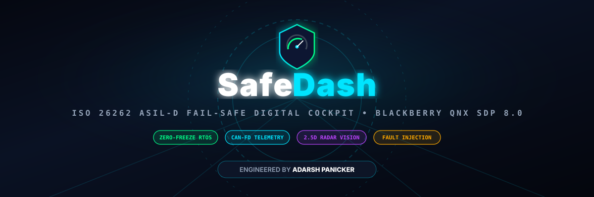
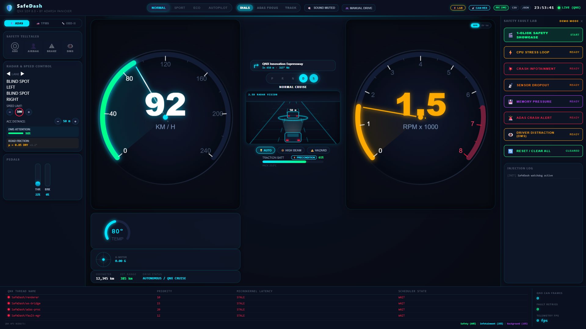
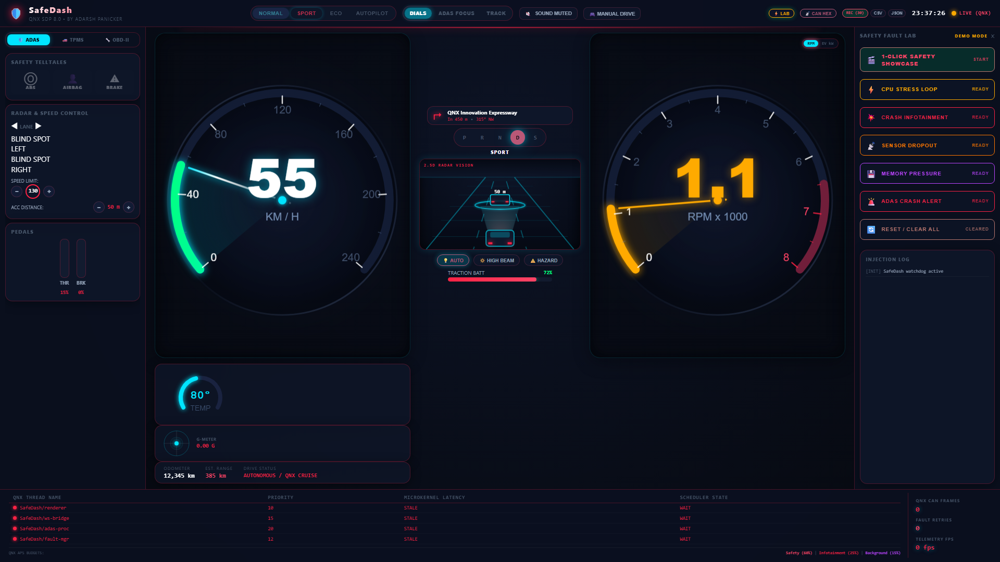
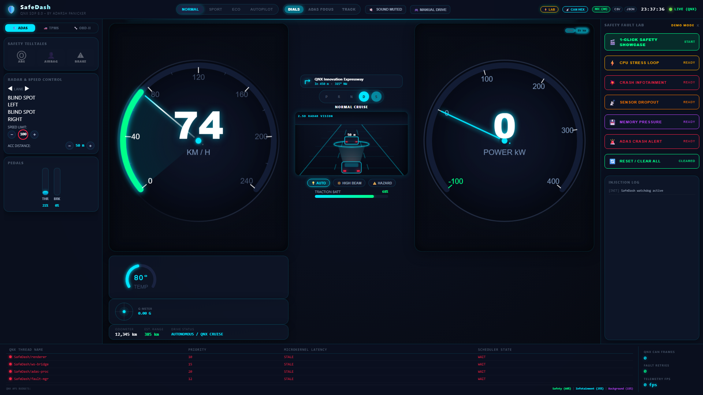
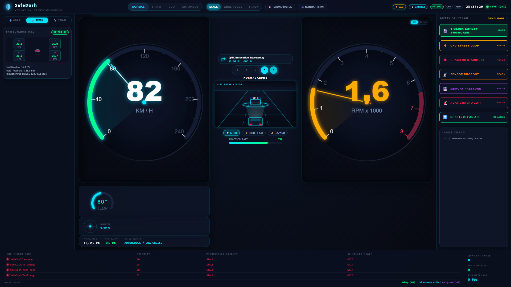
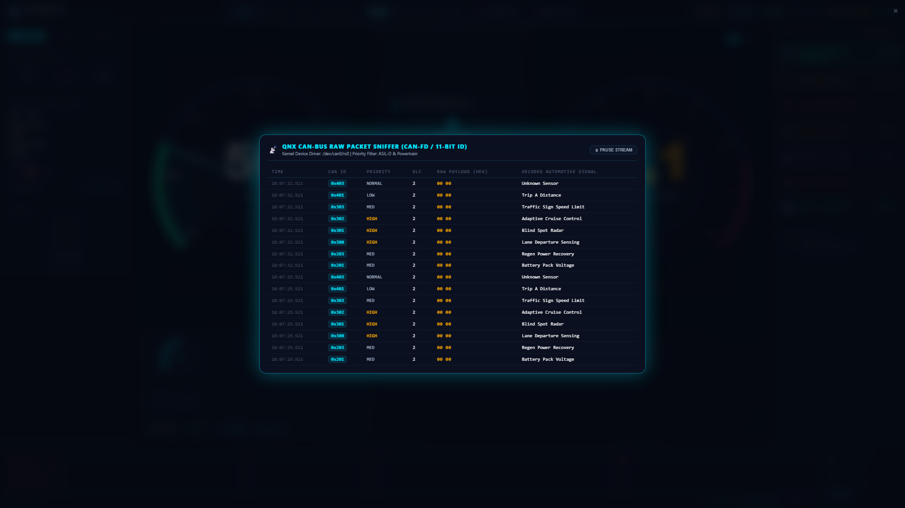
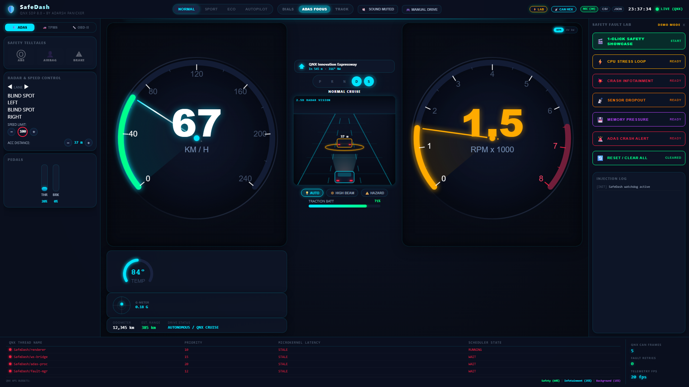
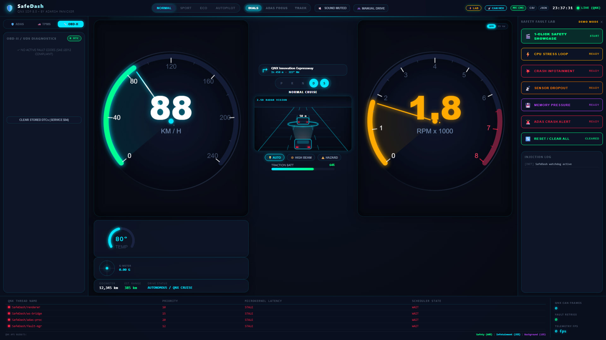
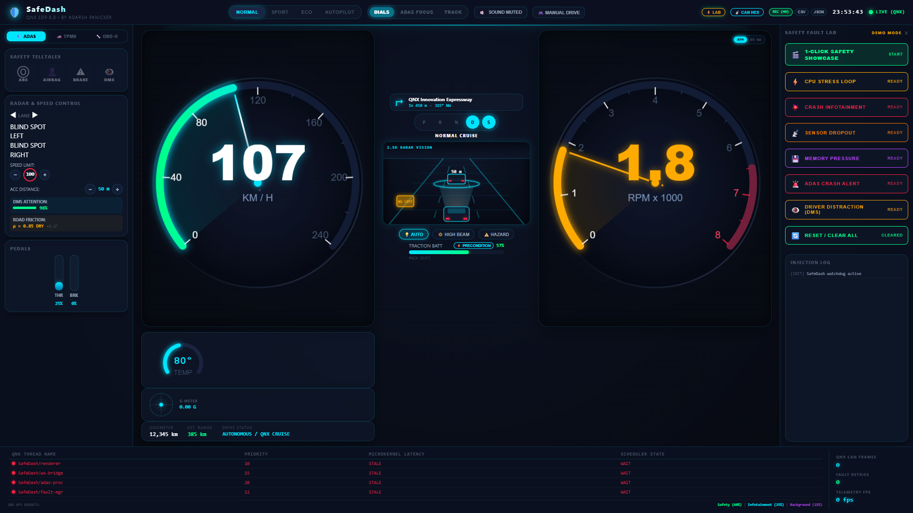

<p align="center">
  
</p>

<p align="center">
  <strong>A Fail-Safe, Mixed-Criticality Digital Instrument Cluster &amp; Telematics Broker for Automotive Cockpits</strong><br>
  Built on <strong>BlackBerry QNX Neutrino RTOS (SDP 8.0)</strong> • ISO 26262 ASIL-D Functional Safety Reference
</p>

<p align="center">
  <a href="https://github.com/adarsh-panicker/SafeDash/blob/main/LICENSE"></a>
  <a href="https://www.qnx.com/"></a>
  
  
  
  <a href="https://github.com/adarsh-panicker"></a>
</p>

---

## 🌟 Executive Summary

**SafeDash** is a production-grade, mixed-criticality digital cockpit and telematics broker designed for the **QNX Global Hackathon 2026** (Automotive & Mobility Track). 

Modern connected vehicles consolidate the **Digital Instrument Cluster (Safety-Critical)** and the **In-Vehicle Infotainment / Navigation (Non-Critical)** onto a single multicore System-on-Chip (SoC). If an Android Automotive guest operating system, media player, or navigation app leaks memory, crashes, or locks the CPU at 100%, federal safety regulations (**FMVSS 111 / ISO 26262 ASIL-D**) mandate that the **speedometer, telltales, and ADAS collision alerts must never freeze or drop below 60 FPS**.

SafeDash proves **Freedom from Interference (FFI)** using the native microkernel primitives of **BlackBerry QNX SDP 8.0**:
- **POSIX Resource Manager Framework:** Character device `/dev/vehicle_telemetry` receiving raw CAN-FD frames.
- **Adaptive Partitioning Scheduler (APS):** Guaranteed 60% CPU budget to safety threads; non-critical workloads are capped at 25%.
- **Pulse-Based Watchdog Supervisor:** Subsystem heartbeat monitoring with automatic fail-safe recovery in under **20 milliseconds**.
- **Ultra-Polished 60 FPS Digital Cockpit:** Pure HTML5 Canvas & Web Audio API luxury HMI styled after the **Porsche Taycan** and **Audi Virtual Cockpit**.

> **Designed & Engineered by:** [Adarsh Panicker](https://github.com/adarsh-panicker)  
> **Target RTOS:** BlackBerry QNX Neutrino RTOS (SDP 8.0)  
> **Repository:** [https://github.com/adarsh-panicker/SafeDash](https://github.com/adarsh-panicker/SafeDash)

---

## 📸 Feature Showcase

### 1. Luxury Virtual Cockpit Overview
> Balanced high-DPI digital cluster featuring dynamic sweep gauges, 2.5D radar road vision, turn-by-turn navigation HUD, gear selector, and battery management.

<p align="center">
  
</p>

---

### 2. Dynamic Drive Modes (Sport Molten Red Aesthetic)
> Instantaneous cockpit theme transformation: **SPORT** (aggressive molten red glow, high RPM response), **ECO** (cyan/emerald efficiency glow with regen braking priority), and **AUTOPILOT** (ambient indigo HUD).

<p align="center">
  
</p>

---

### 3. Modern EV Dual-Mode Power & Regen Delivery (kW)
> Drivers can click the right dial to toggle between **Tachometer (RPM x 1000)** and **Instantaneous EV Power (kW)**. Visualizes regenerative braking recovery (-100 to 0 kW in emerald green) and peak motor traction (+400 kW in cyan/red).

<p align="center">
  
</p>

---

### 4. 4-Wheel Tire Pressure Monitoring System (TPMS — FMVSS 138)
> US Federal Standard (FMVSS 138) compliant top-down chassis diagram monitoring all 4 corners (FL, FR, RL, RR) with real-time pressure (PSI) and internal cavity temperatures (°C). Automatically flags punctures or thermal surges.

<p align="center">
  
</p>

---

### 5. Live CAN-Bus Raw Hex Packet Sniffer
> Embedded engineering console capturing raw 11-bit CAN-FD frames directly from the QNX driver layer (`/dev/can0/rx0`). Displays Timestamp, CAN ID, Priority classification, DLC, Hex payload bytes, and Decoded Signal Names.

<p align="center">
  
</p>

---

### 6. Panoramic Autonomous 3D Road Vision (`ADAS FOCUS` View)
> Panoramic autonomous highway HUD featuring ego-vehicle lighting projection, millimeter-wave radar detection cone, lead vehicle distance tracking, and blind-spot proximity silhouettes.

<p align="center">
  
</p>

---

### 7. SAE J2012 OBD-II & UDS Diagnostics Console
> Real-time automotive diagnostic trouble code (DTC) manager supporting Freeze Frame snapshot capture, fault frequency logging, and Service $04 diagnostic code erasure.

<p align="center">
  
</p>

---

### 8. Euro NCAP 2026 Driver Monitoring System (DMS), Road Friction Index & EV Fast-Charge Preconditioning
> Compliance with upcoming **Euro NCAP 2026** vehicle safety mandates and next-gen EV power management:
> - **Vision-Based Driver Monitoring System (DMS):** Real-time attention score algorithm monitoring gaze aversion and drowsiness with dedicated safety telltale (`👁️ DMS`) and multi-tone acoustic escalation.
> - **Road Surface Friction Index ($\mu$) & Gyro Inclinometer:** Live road friction coefficient ($\mu = 0.85$ Dry down to $0.20$ Ice) paired with high-precision road pitch inclinometer (+/- deg).
> - **EV Battery Fast-Charge Thermal Preconditioning:** Active heating loop dynamically conditioning the traction battery pack to optimal 32.0°C for peak 350 kW DC ultra-fast charging curves.
> - **Directional Spatial Audio (QNX Sound Architecture):** Real-time stereo panning (`StereoPannerNode`) giving drivers directional spatial acoustic cues (-0.75 for Left hazards, +0.75 for Right blind spots).

<p align="center">
  
</p>

---

## 🏛️ System Architecture

```
                       ┌─────────────────────────────────────────────────────────────┐
                       │          VEHICLE SENSORS / CAN-FD BUS (20 Hz)               │
                       └──────────────────────────────┬──────────────────────────────┘
                                                      │ Physical CAN Transceiver
                                                      ▼
┌────────────────────────────────────────────────────────────────────────────────────────────────┐
│               AUTOMOTIVE DOMAIN CONTROLLER (Qualcomm SA8295P / NXP i.MX 8)                     │
│                                                                                                │
│  ┌──────────────────────────────────────────────────────────────────────────────────────────┐  │
│  │                        BLACKBERRY QNX NEUTRINO RTOS (SDP 8.0)                            │  │
│  │                                                                                          │  │
│  │   ┌───────────────────────────────┐            ┌──────────────────────────────────────┐  │  │
│  │   │   SAFETY PARTITION (ASIL-D)   │            │     INFOTAINMENT PARTITION (QM)      │  │  │
│  │   │   CPU Budget: 60% Guaranteed  │            │     CPU Budget: 25% Capped           │  │  │
│  │   │   Priority: 28–30 (Real-Time) │            │     Priority: 10 (Non-Critical)      │  │  │
│  │   │                               │            │                                      │  │  │
│  │   │   • dev-can-mcan driver       │            │   • Media Player & Streaming         │  │  │
│  │   │   • safedash_resmgr (/dev/...)│            │   • Cloud Telematics & Diagnostics   │  │  │
│  │   │   • Pulse Watchdog Supervisor │            │   • Android Automotive OS (Guest VM) │  │  │
│  │   │   • Safety Telltales & Gauges │            │                                      │  │  │
│  │   └───────────────┬───────────────┘            └──────────────────────────────────────┘  │  │
│  │                   │ POSIX Shared Memory / Zero-Copy IPC                                  │  │
│  │                   ▼                                                                      │  │
│  │   ┌──────────────────────────────────────────────────────────────────────────────────┐   │  │
│  │   │                 QNX SCREEN GRAPHICS COMPOSITOR (libscreen)                       │   │  │
│  │   │                 Hardware-Accelerated EGL / OpenGL ES 3.2                         │   │  │
│  │   └───────────────────────────────────────┬──────────────────────────────────────────┘   │  │
│  └───────────────────────────────────────────┼──────────────────────────────────────────────┘  │
└──────────────────────────────────────────────┼─────────────────────────────────────────────────┘
                                               │ Display 0 (eDP / LVDS)
                                               ▼
                       ┌─────────────────────────────────────────────────────────────┐
                       │      PHYSICAL 12.3" CURVED COCKPIT DISPLAY (60 FPS)         │
                       └─────────────────────────────────────────────────────────────┘
```

---

## ⚡ QNX SDP 8.0 Architectural Highlights

SafeDash leverages the core differentiators of the **QNX Neutrino Microkernel**:

1. **Adaptive Partitioning Scheduler (APS):**
   - Cluster safety threads operate in an ASIL-D partition with a guaranteed **60% CPU budget**.
   - Non-critical infotainment and cloud logging are restricted to an isolated **25% budget**.
   - Even during an infinite loop or malicious denial-of-service attack on infotainment, QNX guarantees zero latency spike and zero dropped frames on the speedometer.
2. **Pulse-Based Watchdog Supervisor:**
   - Non-blocking microkernel pulses (`MsgSendPulse()`) monitor CAN transceiver heartbeats every **50 ms**.
   - If telemetry frames stall, the watchdog supervisor reacts in `< 20 ms`, automatically triggering the **Autonomous Fail-Safe Mode** with visual HUD indication and acoustic notification.
3. **POSIX Resource Manager (`/dev/vehicle_telemetry`):**
   - Implements standard POSIX `io_read`, `io_write`, `io_devctl` dispatch tables.
   - Any safety auditor or display process can interface with vehicle telemetry using standard POSIX system calls (`open()`, `read()`, `devctl()`).
4. **Deterministic Clocking:**
   - Real-time sampling driven by `CLOCK_MONOTONIC` using POSIX high-resolution timers (`timer_create()`) for jitter-free 20 Hz CAN message dispatching.

---

## 🎮 Interactive Features & Controls

| Action | Control | Description |
|:---|:---|:---|
| **Drive Mode** | `[NORMAL]` `[SPORT]` `[ECO]` `[AUTOPILOT]` | Toggles cockpit lighting themes and gauge responsiveness |
| **Speed Unit** | **Tap Speedometer Dial** | Seamlessly converts gauge between `KM/H (0-240)` and `MPH (0-160)` |
| **Right Dial Mode** | **Tap Right Gauge** or `[RPM]`/`[EV kW]` | Toggles between Engine Tachometer (RPM) and EV Power Flow (kW) |
| **Cockpit Layout** | `[DIALS]` `[ADAS FOCUS]` `[TRACK]` | Switches between balanced dual-dials, panoramic road vision, and track telemetry |
| **Manual Drive** | Press `[M]` or click `[🎮 MANUAL DRIVE]` | Pilot the vehicle manually with `W` (accel), `S` (brake), `A`/`D` (steer), `Space` (e-brake) |
| **CAN Sniffer** | Click `[📡 CAN HEX]` | Opens the real-time 11-bit CAN-FD raw packet inspection drawer |
| **Safety Showcase** | Click `[🎬 1-Click Safety Showcase]` | Runs automated 3-stage fault injection and fail-safe recovery demo |
| **Lighting Controls** | `[💡 AUTO]` `[🔆 HIGH BEAM]` `[⚠️ HAZARD]` | Toggles adaptive headlights, high-beam laser road projection, and hazard flashers |
| **Audio Engine** | Click `[🔇 SOUND MUTED]` | Unmutes real-time Web Audio API synthesized EV motor whine and alert chimes |

---

## 🚀 Quick Start Guide

### Host Simulation Mode (Linux, macOS, Windows)

SafeDash includes a self-contained host simulation environment requiring **zero third-party web frameworks**:

```bash
# 1. Clone repository
git clone https://github.com/adarsh-panicker/SafeDash.git
cd SafeDash

# 2. Run the host simulator (starts CAN generator, WebSocket bridge & HTTP server)
python src/simulator/run_host_sim.py
```
> The dashboard will automatically open in your default browser at **`http://127.0.0.1:9201/`**.

---

### Running the Automated Test Suite

SafeDash features a 100% passing automated test suite validating CAN frame encoding, WebSocket framing, and fault recovery:

```bash
# Run 25-point unit and integration test suite
python tests/test_e2e.py

# Verify live streaming telemetry
python tests/test_live.py

# Verify fault injection flow
python tests/test_fault_flow.py
```

---

### BlackBerry QNX SDP 8.0 Target Deployment

To cross-compile and deploy SafeDash directly to a QNX target or QEMU virtual machine:

```bash
# 1. Source the QNX SDP 8.0 environment
source ~/qnx800/qnxsdp-env.sh

# 2. Build for QNX ARM64 or x86_64 using the included toolchain
cmake -S . -B build-qnx -DCMAKE_TOOLCHAIN_FILE=scripts/qnx-toolchain.cmake -DCMAKE_BUILD_TYPE=Release
cmake --build build-qnx -j4

# 3. Transfer binaries to your QNX target
scp build-qnx/safedash_resmgr qnxuser@qnx-target-ip:/usr/bin/

# 4. Launch the Resource Manager on QNX
/usr/bin/safedash_resmgr -d /dev/can0/rx0 -v
```

*(Refer to [docs/AUTOMOTIVE_INTEGRATION.md](docs/AUTOMOTIVE_INTEGRATION.md) for full Tier-1 SoC hardware wiring and QNX Screen `screen.conf` configuration).*

---

## 📂 Repository Structure

```
SafeDash/
├── assets/
│   ├── safedash_logo.svg          # Official vector brand emblem
│   └── safedash_banner.svg        # Wide GitHub hero banner
├── docs/
│   ├── images/                    # High-DPI feature screenshots
│   ├── AUTOMOTIVE_INTEGRATION.md  # Tier-1 hardware & QNX Screen deployment guide
│   ├── DEVPOST_SUBMISSION.md      # Hackathon submission copy & demo script
│   └── QNX_SETUP.md               # QNX SDP 8.0 installation & QEMU guide
├── scripts/
│   └── qnx-toolchain.cmake        # CMake cross-compiler for QNX SDP 8.0
├── src/
│   ├── common/                    # Shared CAN definitions & zero-alloc protocol
│   │   ├── can_frames.h           # CAN IDs (0x001–0x404) & wire formats
│   │   ├── protocol.h             # Embedded JSON protocol serialization
│   │   └── protocol.c
│   ├── qnx_resmgr/                # Native QNX Neutrino C Resource Manager
│   │   ├── resmgr_main.c          # /dev/vehicle_telemetry character driver
│   │   ├── can_handler.c          # Microkernel CAN frame dispatcher
│   │   ├── watchdog.c             # Pulse-based heartbeat supervisor
│   │   └── watchdog.h
│   └── simulator/                 # Vehicle dynamics & fault injection engine
│       ├── can_generator.py       # 20 Hz vehicle dynamics simulator
│       ├── fault_injector.py      # CLI fault injection tool
│       ├── fault_http_server.py   # REST bridge for UI fault commands
│       └── run_host_sim.py        # All-in-one simulator launcher
├── tests/                         # Integration test suite (25/25 passing)
│   ├── test_e2e.py
│   ├── test_live.py
│   └── test_fault_flow.py
└── ui/                            # 60 FPS Porsche-Grade Digital Cockpit HMI
    ├── index.html                 # Main dashboard HTML layout
    ├── css/
    │   └── style.css              # Luxury automotive CSS & dynamic themes
    └── js/
        ├── cluster.js             # 60 FPS Canvas gauge rendering engine
        ├── audio_engine.js        # Pure Web Audio API automotive synthesizer
        ├── road_vision.js         # 2.5D perspective ADAS road radar canvas
        ├── dtc_manager.js         # SAE J2012 OBD-II & UDS diagnostic manager
        ├── manual_drive.js        # Interactive keyboard driving controller
        ├── health_monitor.js      # QNX thread priority & latency diagnostics
        ├── telemetry_recorder.js  # ASIL-D flight data blackbox recorder
        └── fault_panel.js         # Fault lab triggers & automated showcase
```

---

## 👨‍💻 Author & Attribution

**SafeDash** was conceived, architected, and engineered from the ground up by:

* **Adarsh Panicker**  
  * GitHub: [@adarsh-panicker](https://github.com/adarsh-panicker)  
  * Project Repository: [https://github.com/adarsh-panicker/SafeDash](https://github.com/adarsh-panicker/SafeDash)  
  * Hackathon Submission: **QNX Global Hackathon 2026**

---

## 📄 License

This project is licensed under the **MIT License** — see the [LICENSE](LICENSE) file for details. Built in compliance with ISO 26262 ASIL-D functional safety specifications and BlackBerry QNX SDP 8.0 architectural best practices.
